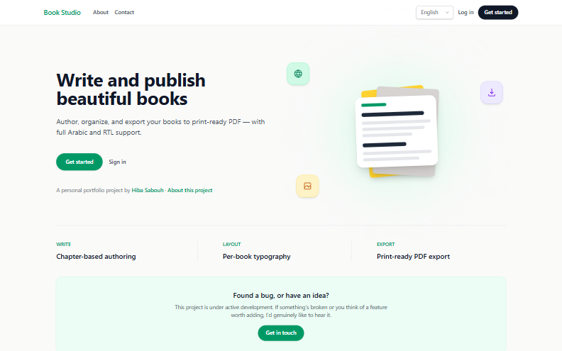
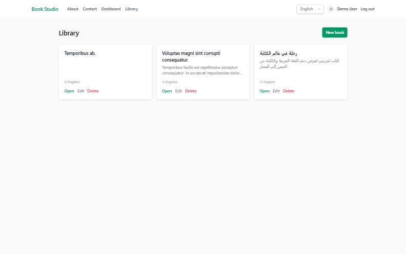
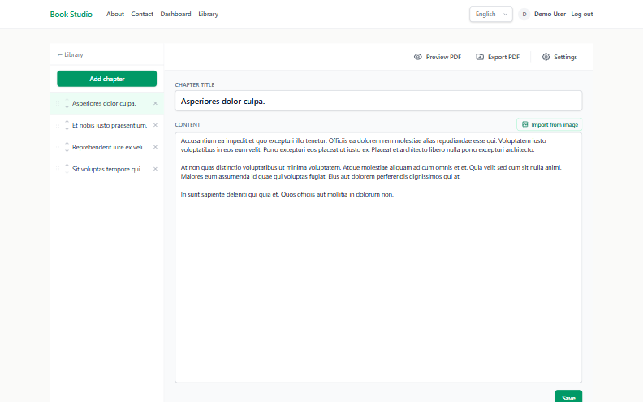
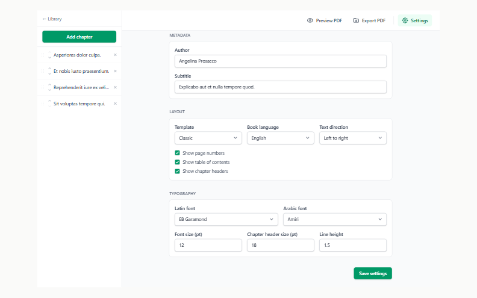
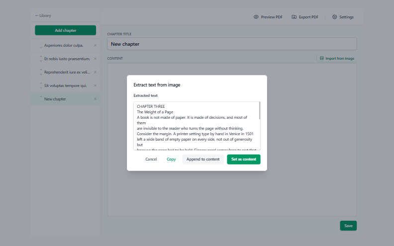
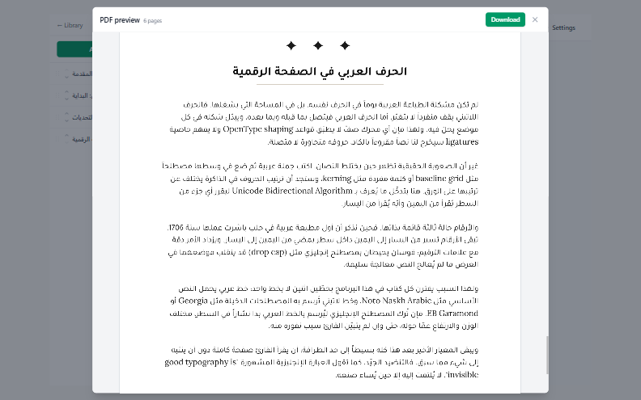
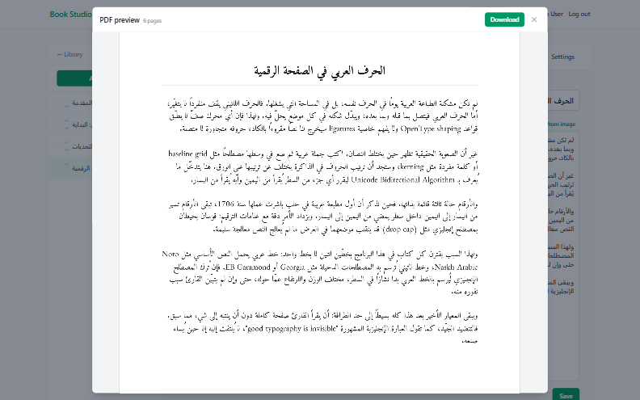
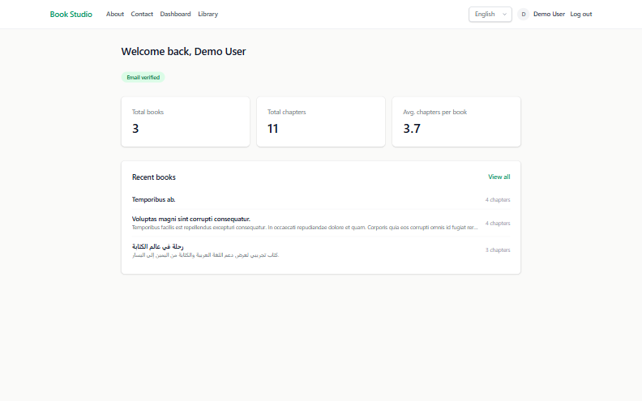
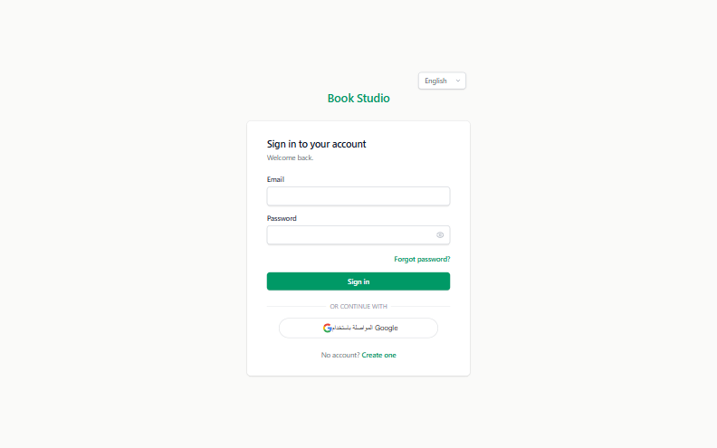
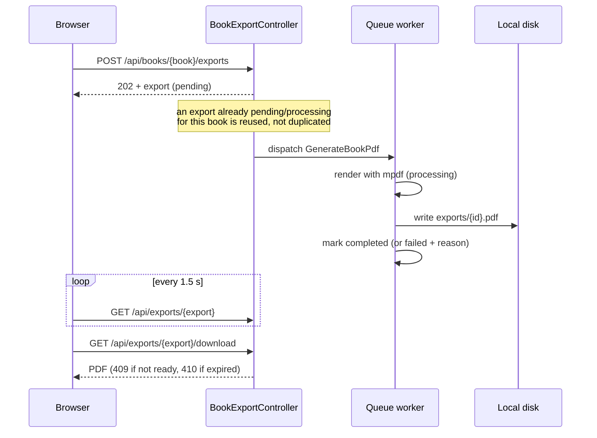

# Book Studio

[](https://github.com/hibasabouh/book-studio/actions/workflows/ci.yml)
[](LICENSE)


Author a book as a set of chapters, style it, and export it to a polished PDF — with OCR-assisted content entry, per-book typography, and Arabic/RTL support.

## Contents

- [Overview](#overview)
- [Screenshots](#screenshots)
- [Features](#features)
- [Tech stack](#tech-stack)
- [Architecture](#architecture)
- [Key engineering decisions](#key-engineering-decisions)
- [Getting started](#getting-started)
- [Configuration](#configuration)
- [Running in production](#running-in-production)
- [API](#api)
- [Tests and code style](#tests-and-code-style)
- [Project structure](#project-structure)
- [Roadmap](#roadmap)
- [License](#license)

## Overview

Book Studio lets an authenticated user create a book, write and reorder its chapters (with drag-and-drop), give it a cover image, and configure per-book layout and typography — template, fonts, text direction, language, font size, line height, and whether to show page numbers, a table of contents, and chapter headers. When ready, the book is previewed in the browser and exported to a PDF rendered in one of four templates (classic, elegant, manuscript, modern), including correct Arabic/RTL rendering and a table of contents whose entries link to their chapters. Chapter content can also be seeded by uploading a scanned image and running it through OCR instead of typing it out.

The app ships with a small admin back-office (dashboard stats, user management, a contact-message inbox) and supports English, Arabic, and French across both the backend and the client.

## Screenshots



| | |
| --- | --- |
|  |  |
| **Library** — every book on one dashboard | **Chapters** — write, edit, and reorder by drag-and-drop |
|  |  |
| **Typography** — template, font pairing, direction, spacing | **OCR** — pull text from a scanned page into a chapter |
|  |  |
| **Arabic export** — correct shaping, direction, and mixed-script runs | **Templates** — one chapter, four ways to set it |
|  |  |
| **Dashboard** — totals and recent books at a glance | **Auth** — password, Google sign-in, OTP verification |

## Features

### Writing

- Book and chapter management, including drag-and-drop chapter reordering (SortableJS)
- OCR-assisted chapter content entry from an uploaded image or PDF (JPG, PNG, BMP, GIF, PDF; up to 1 MB), with a selectable OCR language
- Book cover images — framed in the browser at the printed page's ratio, then cropped and re-encoded server-side and rendered as a full-bleed cover page in the export

### Typography and layout

Every book has its own settings, validated on the request and enum-cast on the model:

| Setting | Options / range | Default |
| --- | --- | --- |
| Template | `classic`, `modern`, `elegant`, `manuscript` | `classic` |
| Language | English, Arabic, French — also localizes template labels such as "Table of Contents" | English |
| Text direction | LTR / RTL | LTR |
| Latin font | EB Garamond, Playfair Display, Merriweather, Lora, Crimson Pro, Libre Baskerville, Cardo | EB Garamond |
| Arabic font | Amiri, Cairo, Noto Naskh Arabic, Tajawal, El Messiri, Lateef, Reem Kufi | Amiri |
| Body font size | 8–72 pt | 12 |
| Chapter header size | 8–72 pt | 18 |
| Line height | 1–3 | 1.5 |
| Author, subtitle | Free text | — |
| Page numbers / table of contents / chapter headers | On or off | On |

All 14 font families are bundled in `storage/fonts/`, so PDF rendering never downloads fonts at runtime.

### Export

- PDF export in 4 templates on A4, with Arabic/RTL support and OpenType shaping and kashida justification for Arabic fonts
- **Mixed-script text**: an Arabic quote inside an English book (or an English term inside an Arabic one) is automatically set in the book's secondary font, so both scripts render with the right glyphs
- A generated table of contents whose entries jump to their chapter, plus a matching PDF outline for the reader's sidebar
- In-browser preview of the generated PDF (pdf.js) before downloading it
- Queued export with status polling and a completion notice that follows you across pages and browser tabs; download filenames keep the book's original (including Arabic) title

### Accounts and administration

- Registration/login, email verification and password reset via OTP, Google sign-in
- Profile editing, password change, and avatar upload
- Account statuses (active / inactive / suspended) — blocking an account takes effect immediately, not at next login
- Admin panel: dashboard stats, user management, contact-message inbox
- Public contact form with categories and up to 5 attachments, delivered by email and kept in the admin inbox

### Localization

- English / Arabic / French on both the backend and the client, with RTL page layout for Arabic
- API error messages (401, 403, 404, 429, 500…) and the HTML error pages are translated too

## Tech stack

- **Laravel 12** on PHP 8.2+, MySQL
- **Laravel Sanctum** for auth — stateful SPA cookie auth for the web app plus token auth for API clients, from one codebase
- **Blade + Alpine.js 3 + Tailwind v4 (Vite)** on the frontend — Blade renders page shells, Alpine + `fetch` drive the JSON API. This is a deliberate choice over a full SPA framework: the app's interaction surface (forms, drag-and-drop reorder, a settings panel) doesn't need client-side routing or a virtual DOM, so a heavier framework would add build complexity without a matching benefit
- **mpdf** for PDF generation (4 templates, RTL/Arabic-aware, linked table of contents)
- **pdf.js** for previewing a generated export in the browser before download
- **SortableJS** for drag-and-drop chapter reordering
- **GD** for cover images — server-side crop, resize, and re-encode
- **Laravel queues** (database driver) for PDF export, and the scheduler for cleanup
- **dedoc/scramble** for auto-generated OpenAPI docs from the existing route/request/resource definitions
- **Pest** for testing, **Pint** for code style, **GitHub Actions** for CI

## Architecture

The browser and any external API client talk to the same JSON API in `routes/api.php`. The web app authenticates with a Sanctum session cookie; other clients use bearer tokens. `routes/web.php` only serves Blade page shells, plus the session login/register/logout endpoints.

```
Browser (Blade shell + Alpine)  ──cookie──┐
                                          ├──►  routes/api.php  ──►  Form Request (validate + authorize via Policy)
API client                      ──token───┘                          └─►  Controller  ──►  Service  ──►  Model / Resource
```

- **Form Requests** do both validation and authorization: each one's `authorize()` asks the relevant Policy, so controllers stay thin.
- **Services** hold logic with an external or heavyweight dependency: `BookExportService` (mpdf), `CoverImageService` (GD), `OcrService` (OCR.space), `GoogleAuthService` (Google tokeninfo), `OtpService` (codes and mail).
- **API Resources** shape every JSON response, which is also what Scramble reads to document the API.
- **Global middleware** `SetLocale` resolves the language for every request, so even errors raised before a route matches are translated.

### PDF export pipeline



- The job runs once (`tries = 1`) with a 120 s timeout. A failure is stored as a reason code (`render_failed`, `timed_out`, `unexpected`) rather than a message, so it is translated into the language of whoever polls, not the worker's.
- The client keeps tracked exports in `localStorage`, so polling resumes on whatever page you open next and the "ready" notice survives navigation. If an export stays `pending` for 20 s, the UI warns that no queue worker appears to be running.
- Generated files are kept for 24 hours: `model:prune` runs daily and deletes old export rows along with their files.
- The preview endpoint renders synchronously and returns the PDF base64-encoded in JSON, which keeps browser PDF viewers and extensions from intercepting it before pdf.js can render it.

## Key engineering decisions

- **OTP-based email verification and password reset** instead of Laravel's default signed-URL flow, because the same verification path has to work for both the cookie-based web session and token-based API clients — a short-lived code works uniformly across both, a signed URL does not. Codes are 6 digits, stored hashed, valid for 10 minutes, and issuing a new one invalidates any outstanding code for the same purpose.
- **Google OAuth alongside password auth**, isolated behind a dedicated `GoogleAuthService` so the rest of the auth flow (OTP, session/token issuance) doesn't need to know which identity provider was used. ID tokens are verified against Google's tokeninfo endpoint, and the audience and issuer are checked as well.
- **Enum-backed casts on `BookSetting`** (template, fonts, direction, language) rather than free-form strings, so invalid layout configuration is rejected at the model boundary instead of surfacing as a broken PDF render.
- **Ownership-scoped `BookPolicy` / `ChapterPolicy` / `BookExportPolicy` plus a single `admin` Gate**, instead of a full roles-and-permissions package — the app only has two authorization shapes (owns-the-resource, is-an-admin), so a package would add configuration surface without covering any case Policies and a Gate don't already handle.
- **Account blocking revokes access on the spot**: the `active` middleware deletes the bearer token in use, or invalidates the web session, as soon as a blocked user makes a request. Logout stays reachable so a blocked user can still end their session.
- **Cover uploads are re-encoded, never stored as received** (`CoverImageService`): the browser sends a crop rectangle as fractions of the source, the server re-applies it to the original at full resolution and writes a fresh JPEG at A4/150dpi. SVG is rejected outright — it can carry script and would be served from our own origin — and a dimension cap bounds GD's memory use. Re-encoding is also what strips EXIF.
- **Script-aware font switching** (`ScriptFontFormatter`): a book has one primary script and a Latin/Arabic font pair. Runs of the other script are wrapped in a span carrying the secondary font, applied to individual text values (escaped after matching) rather than to the rendered page, so markup and HTML entities are never split.
- **OCR via a direct HTTP call to the OCR.space API** (`OcrService`, using the `Http` facade) rather than an SDK, since the integration is a single endpoint call — a dependency would outweigh the code it replaces.
- **Translated, non-leaky JSON errors** (`LocalizedErrorRenderer`): framework error messages are replaced with translated ones, and database exceptions always come back as a generic 500 — never SQL — even with `APP_DEBUG` on. The full error is still logged.
- **Parallel i18n on both sides**: backend strings in `lang/{en,ar,fr}`, frontend strings in `resources/js/i18n/{en,ar,fr}.json`, kept in sync by convention so a translation change never has to touch only one layer.

## Getting started

Requires PHP 8.2+ (with the `gd` and `mbstring` extensions, both required by mpdf), Composer, Node 20+, and MySQL.

```bash
git clone https://github.com/hibasabouh/book-studio.git
cd book-studio
cp .env.example .env
```

Create the database and point `.env` at it (`DB_DATABASE=book_studio` by
default), then run the one-shot setup script:

```bash
composer setup
```

That installs the PHP and JS dependencies, generates an app key, links
`storage/app/public` into `public/storage` (uploaded images are served from
there), runs the migrations, and builds the frontend assets. The equivalent
long form is:

```bash
composer install
php artisan key:generate
php artisan storage:link
php artisan migrate
npm install
npm run build
```

For local development, `composer run dev` starts the app server, queue listener, log viewer (Pail), and Vite dev server together. PDF exports run on the queue, so if you serve the app another way, also run `php artisan queue:work` — otherwise exports stay queued.

### Demo data

```bash
php artisan db:seed
```

Seeds an admin, a demo user, 8 random users, and a couple of chaptered books
per demo account — including an Arabic/RTL one, so the export path is easy to
try. The two named accounts are stable across re-seeds:

| Email | Password | Role |
| --- | --- | --- |
| `admin@bookstudio.test` | `password` | Admin |
| `user@bookstudio.test` | `password` | User |

These are local development credentials only — never seed them anywhere reachable from the internet.

## Configuration

Everything works out of the box for local use except the features below, which need their own keys:

| Variable | Purpose |
| --- | --- |
| `GOOGLE_CLIENT_ID` | Enables "Sign in with Google" (an OAuth client ID from Google Cloud Console) |
| `OCRSPACE_API_KEY` / `OCRSPACE_ENDPOINT` | Enables OCR-assisted chapter content (the [OCR.space](https://ocr.space/ocrapi) free tier works) |
| `MAIL_*` | Delivery for OTP codes and contact messages. The default `MAIL_MAILER=log` writes emails, including OTP codes, to `storage/logs/laravel.log` |
| `CONTACT_RECIPIENT_EMAIL` | Where contact form submissions are sent; falls back to `MAIL_FROM_ADDRESS` |
| `SANCTUM_STATEFUL_DOMAINS` | Must list the host:port you serve the app from, or cookie-authenticated requests come back 401 |
| `QUEUE_CONNECTION` | `database` by default; any Laravel queue driver works |

With the default log mailer, you can complete registration locally by reading the verification code from the log.

## Running in production

Beyond a standard Laravel deployment (`APP_ENV=production`, `APP_DEBUG=false`, `php artisan optimize`, `npm run build`):

- **Run a queue worker** (`php artisan queue:work`) under a process supervisor — without one, exports never leave `pending`.
- **Run the scheduler** (`* * * * * php artisan schedule:run`) so `model:prune` clears expired exports and their PDF files daily.
- **Keep the job timeout below `retry_after`.** `GenerateBookPdf` times out at 120 s; the database queue's `retry_after` is 180 s (`DB_QUEUE_RETRY_AFTER`). Lowering it below the job timeout would let a slow render be picked up twice.
- **Run `php artisan storage:link`** so cover images and avatars are served from `public/storage`.
- **Configure a real mailer** — OTP verification and password reset depend on email delivery.
- A health check is available at `/up`.

## API

The JSON API (`routes/api.php`) is documented automatically from its route/request/resource definitions via [Scramble](https://scramble.dedoc.co/). With the app running locally, the generated OpenAPI docs are at `/docs/api`, including the bearer auth scheme and the `X-Locale` header.

API clients authenticate by calling `/api/register`, `/api/login`, or `/api/auth/google`, which return a Sanctum token to send as `Authorization: Bearer <token>`. Send `X-Locale: en|ar|fr` to choose the language of messages and errors.

| Area | Endpoints |
| --- | --- |
| Auth | `POST /register`, `/login`, `/auth/google`, `/logout`, `/forgot-password`, `/reset-password`, `/email/verify-otp`, `/email/resend-otp`; `GET /user` |
| Profile | `PATCH /profile`, `PUT /profile/password`, `POST /profile/avatar`, `GET /dashboard/stats` |
| Books | `GET/POST /books`, `GET/PATCH/DELETE /books/{book}`, `POST/DELETE /books/{book}/cover` |
| Settings | `GET/PATCH /books/{book}/setting` |
| Chapters | `GET/POST /books/{book}/chapters`, `GET/PATCH/DELETE /chapters/{chapter}`, `POST /books/{book}/chapters/reorder`, `POST /chapters/{chapter}/ocr` |
| Export | `POST /books/{book}/exports`, `GET /exports/{export}`, `GET /exports/{export}/download`, `GET /books/{book}/preview` |
| Admin | `GET /admin/stats`; `GET /admin/users`, `GET/PATCH/DELETE /admin/users/{user}`; `GET /admin/messages`, `GET/PATCH/DELETE /admin/messages/{message}` |

All paths are prefixed with `/api`. OTP and password-reset endpoints, like the public contact form, are throttled to 6 requests per minute.

## Tests and code style

```bash
composer test          # Pest suite
vendor/bin/pint        # format code (CI runs `pint --test`)
```

The suite runs on an in-memory SQLite database — `phpunit.xml` overrides
`DB_CONNECTION` and `DB_DATABASE`, so running the tests never touches your
development database.

CI runs the suite on PHP 8.2, 8.3, and 8.4, and checks formatting with Pint, on every push and pull request to `main`.

Pest feature/unit coverage spans:

- Auth: registration, login, email verification, password reset, Google sign-in, rate limiting
- Books & chapters: CRUD, authorization, reordering, cover upload/crop, OCR-assisted content, per-book settings/typography, queued PDF export (including its failure paths) and preview
- Admin: dashboard stats, user management, contact-message inbox
- Contact form: submission, attachments, validation, mail delivery, throttling
- Error handling: localized error responses and query-exception rendering
- Supporting pieces: models, enums, middleware, mail rendering, seeders, the cover-image and OTP services, mixed-script font formatting, file helpers, and public/authenticated pages

## Project structure

```
app/
├── Enums/            # Template, fonts, language, direction, export status/failure, roles…
├── Exceptions/       # LocalizedErrorRenderer — translated JSON errors
├── Http/
│   ├── Controllers/  # Thin controllers (API + Blade page shells)
│   ├── Middleware/   # SetLocale, EnsureUserIsActive, EnsureEmailIsVerified
│   ├── Requests/     # Validation + Policy-based authorization per action
│   └── Resources/    # JSON response shapes
├── Jobs/             # GenerateBookPdf (queued export)
├── Policies/         # Book, Chapter, BookExport ownership rules
├── Services/         # BookExport, CoverImage, Ocr, GoogleAuth, Otp
└── Support/          # ScriptFontFormatter (mixed-script font runs)
resources/
├── js/               # Alpine modules: auth, i18n, exports polling, cropper, pdf preview
├── js/i18n/          # Frontend translations (en, ar, fr)
└── views/pdf/        # The four PDF templates
lang/                 # Backend translations (en, ar, fr)
storage/fonts/        # Bundled OFL fonts used by mpdf
tests/                # Pest feature and unit tests
```

## Roadmap

The current codebase is a solid core — auth, book/chapter authoring, PDF export, admin panel — with broad Pest feature coverage across auth, books/chapters, admin, contact, and the supporting services. Planned next:

- Public, read-only book sharing links
- Full-text search across books and chapters
- A paid subscription tier via Stripe
- Chapter version history

## License

Book Studio is open source under the [MIT License](LICENSE).

The fonts bundled in `storage/fonts/` are third-party works under the SIL Open
Font License 1.1, not MIT. The OFL lets them be redistributed with this project
as long as the license text and copyright notices travel with them, which they
do — see [storage/fonts/README.md](storage/fonts/README.md).
